### 🚀 About Me

- 3rd semester Computer Science student @ Universitas Indonesia.  
- Staff of Software Engineering Academy @ COMPFEST 18.  
- Super Member @ Google Developer Group on Campus Universitas Indonesia.

### 🛠️ Tech Stack

  
  
  
  
  
  
  
  
  

  
  
  
  
  

  
  
  
  
  
  
  
  
  

### 🔗 Connect With Me

  
    
  
  

### 📊 GitHubStats

  
  

